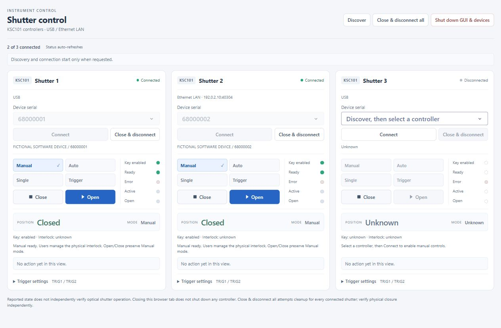

# Thorlabs shutter control

Control KSC101 shutter controllers and SH05R shutters from a web page running on
your Windows computer. KSC101 is the electronic controller; SH05R is the physical
shutter. A Python API and two notebooks are also available.

Connect by USB, directly or through a KEH3/KEH6 USB hub. Ethernet connections use
the documented KEH3 routes. Starting the app does not discover, connect or move
hardware; those actions require explicit requests.

## Before you start

- Use Windows x64 and Python 3.12 x64.
- Install the [Thorlabs Kinesis runtime and drivers](https://www.thorlabs.com/software-pages/Motion_Control).
  Kinesis is the vendor software used to communicate with the controllers.
- Install [uv](https://docs.astral.sh/uv/), the Python environment/dependency tool.
- Close other Kinesis, GUI or notebook sessions that own the same controller.
  Establish the normal physical interlock and independent source protection before
  operating the shutter.

## Install and run

Open PowerShell in this project folder:

```powershell
uv sync --locked
uv run shutter-control
```

The first command creates the local Python environment and installs dependencies.
Kinesis and its device drivers must be installed separately. Open
[localhost:8050](http://127.0.0.1:8050/) in your browser after launching.

## First use

Each panel represents one controller. Start in **Manual** mode for a basic cycle.

1. Click **Discover** to find USB and Ethernet controllers.
2. Select the intended device in a panel, then click **Connect**. Check its identity
   and reported state. Connect does not enable the channel or change its output.
3. Establish **Inactive / Closed** before selecting a mode. Read the panel hint if
   a control is disabled. The GUI assumes an enabled channel; if setup is needed,
   follow the [explicit setup sequence](docs/python-api.md#connection-and-manual-control).
4. Use **Open** and **Close** in Manual mode. Single, Auto and Trigger modes use
   **Start / Stop**; see the [GUI guide](docs/gui.md) before using them.
5. Finish with **Shut down GUI & devices**, then independently verify closure.
   Closing the browser tab does not stop the server or release controllers.



The screenshots use fictional software devices. Reported position and Ready
indicators do not independently prove blade motion or optical closure.

## Configuration

Edit [config.py](src/thorlabs_shutter_control/config.py), then restart the app.
You can leave serials and endpoints empty and select discovered devices in the GUI.

| Setting | When to change it |
| --- | --- |
| KINESIS_DIR | Kinesis is installed outside C:/Program Files/Thorlabs/Kinesis |
| SERIAL_NUMBERS / ETHERNET_ENDPOINTS | You want optional device/route preselection |
| SLOTS | You want a different panel count; the default USB view has three |
| LAN_SCAN_START_IP / LAN_SCAN_END_IP | Your KEH3 is outside the default 192.168.1.0 through 192.168.1.255 range, or you want a narrower scan |
| LAN_SCAN_MAX_ADDRESSES / LAN_SCAN_OPEN_TIMEOUT_MS | You need to adjust the bounded LAN scan; defaults are 256 addresses and 100 ms per address |
| PORT | Another app uses the default localhost port 8050 |

Actual serials and addresses belong in local configuration, not shared commits.
A full LAN scan requires all process-owned controller handles to be released.
See [setup and troubleshooting](docs/getting-started.md) for exact settings.

## Feedback and timing

Feedback means the state reported by the controller. Connect reads operating and
trigger settings together. Apply TTL checks Closed/Inactive/Manual, writes the
trigger settings, and compares the actual readback. Both actions reuse their
result for the display.
TTL refers to the electrical trigger signals configured under **Trigger settings**;
see the [trigger guide](docs/gui.md#trigger-settings) before changing them.

| Action | Software waits at the default 250 ms feedback interval |
| --- | ---: |
| Connect | 250 ms |
| Apply TTL | 500 ms |

These are intentional software waits, not total response times. Discovery, native
calls, queuing, USB/LAN communication and blade motion add time. See
[GUI feedback timing](docs/gui.md#feedback-timing) for details and limits.

## Common questions

| Problem | Next step |
| --- | --- |
| Discover finds nothing | Read the USB/LAN warning; check power, drivers or the configured LAN range |
| Open / Start is disabled | Read the panel hint and check the key and reported operating state |
| A controller is already owned | Release its other GUI/notebook/Kinesis connection; resolve a failed disconnect before reconnecting |
| Connect or Discover takes longer than the timing table | Discovery and native SDK calls are additional; read the diagnostic message |
| The browser was closed | The server can still be running; reopen it and shut down normally, or use terminal Ctrl+C for cleanup |

## Python use and development

Start with the [USB or LAN notebook](docs/examples/README.md) for an explicit
workflow, or the [Python API guide](docs/python-api.md) for scripting. New developers
should read the [developer walkthrough](docs/architecture.md#developer-walkthrough):
it maps the source files, traces a command and describes a first software-only edit.

```powershell
.venv\Scripts\python.exe -B -m pytest -q -p no:cacheprovider
uv run --locked ruff check --no-cache src tests
uv build --wheel
```

The 26 essential tests use fictional devices, virtual waits and actual Dash
callback HTTP. They cover USB/LAN, modes/TTL, identity/ownership, cleanup, one/three
panels, the launcher and both notebooks. They do not contact real hardware or prove
physical timing. Current USB/GUI, live LAN scanning, Ethernet actuation/recovery,
multiple pairs and electrical TTL still need bench qualification. The recorded
active-low no-cable TTL issue remains unresolved.

More detail: [GUI](docs/gui.md), [API](docs/python-api.md),
[hardware and commissioning](docs/HARDWARE_VALIDATION.md),
[delivery report](outputs/REPORT.md), [validation evidence](records/latency-validation.json).
The older baseline tag `baseline-2026-10-21` is provenance, not a new bench result.
