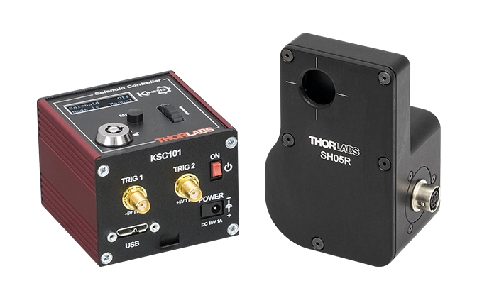
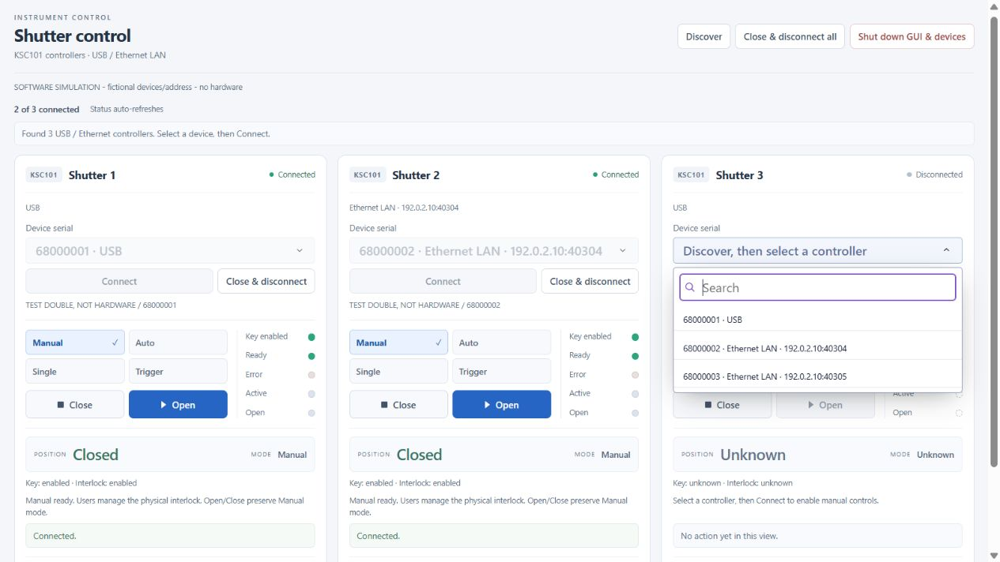

# Thorlabs shutter control

A local Dash GUI and Python API for KSC101 controllers and SH05R shutters.
Connect directly by USB, through KEH3/KEH6 USB hubs, or through documented
KEH3 Ethernet routes. Startup is passive; connection and output actions are explicit.
Current baseline marker: `baseline-2026-10-21`.



Manufacturer photo: [Thorlabs optical shutters](https://www.thorlabs.com/optical-shutters).
It illustrates the device pair, not the test bench.

## Install and launch

Use Windows x64, Python 3.12 x64, [uv](https://docs.astral.sh/uv/) and the
[official Kinesis runtime](https://www.thorlabs.com/software-pages/Motion_Control).
Kinesis and its device drivers are installed separately from Python dependencies.

```powershell
uv sync --locked
uv run shutter-control
```

Open [localhost:8050](http://127.0.0.1:8050/). Close competing Kinesis/notebook
owners and establish independent source protection and the normal physical interlock.

1. Click **Discover**, choose a labelled USB/LAN device, then **Connect**.
2. Read identity/feedback. Establish Inactive/Closed before selecting a mode.
3. Use Open/Close in Manual or Start/Stop in Single, Auto and Trigger.
4. Finish with **Shut down GUI & devices**. Closing the browser does not release hardware.



The capture uses software devices. Ready means application readiness; reported
position does not independently establish blade motion or optical closure.
The GUI assumes an enabled channel; explicit setup is in the [API guide](docs/python-api.md#connection-and-manual-control).

## Configuration

Edit [config.py](src/thorlabs_shutter_control/config.py), then restart the GUI.
No command-line options or environment configuration are needed for launch.

| Setting | Default / purpose |
| --- | --- |
| KINESIS_DIR | C:/Program Files/Thorlabs/Kinesis |
| SERIAL_NUMBERS | Empty tuple; optional distinct panel preselection |
| ETHERNET_ENDPOINTS | Empty tuple; optional per-panel KEH3 IPv4:bay-port, None for USB |
| SLOTS | None: at least three USB panels, or enough for supplied routes/serials |
| LAN_SCAN_START_IP / LAN_SCAN_END_IP | Inclusive192.168.1.0 through192.168.1.255 |
| LAN_SCAN_MAX_ADDRESSES | 256; configurable1..256 |
| LAN_SCAN_OPEN_TIMEOUT_MS | 100ms/address; configurable50..1000 |
| PORT | 8050 on localhost |

Discover supplies detected routes automatically; full range scanning requires all
process handles released. Partial failures remain visible. Connect never falls
back to another transport, and a retained handle cannot be replaced.

## Python API

KCubeShutter is the direct USB API. ShutterHub owns slots, Ethernet and GUI
dispatch. Setters send commands and return None; getters explicitly read feedback.

```python
from thorlabs_shutter_control import KCubeShutter, config

c = KCubeShutter(config.SERIAL_NUMBERS[0])  # Configure the intended serial first.
try:
    c.connect()
    print(c.identify_device())
    print(c.get_operating_status())
finally:
    c.disconnect(close_shutter=False)  # Communication-only release.
```

Two [notebooks](docs/examples/README.md) cover USB and LAN operation with explicit
setup, identity verification and error cleanup. Driver setters do not implement
application readiness checks, automatic recovery or physical closure verification.

## Validation and development

```powershell
.venv\Scripts\python.exe -B -m pytest -q -p no:cacheprovider --ignore=tests/test_sdk.py
uv run --locked ruff check --no-cache src tests
uv build --wheel
```

The excluded SDK test can enumerate real USB hardware when explicitly enabled.
The maintained tests use a fake SDK, virtual waits and real Dash callback HTTP.
Developer preview: `uv run --locked python -B tests/simulated_demo.py --api`.

Physical evidence is limited to recorded configurations. Current GUI/USB paths,
live LAN range scanning, Ethernet actuation/timing, KEH6/multiple pairs, electrical
TTL, physical fault recovery and calibration require bench qualification.
The active-low no-cable position expectation remains unresolved.

| Guide | Content |
| --- | --- |
| [Setup](docs/getting-started.md), [GUI](docs/gui.md) | Configuration, operation and troubleshooting |
| [API](docs/python-api.md), [Architecture](docs/architecture.md), [Interface](docs/INTERFACE.md) | Maintained contracts and implementation |
| [Hardware](docs/hardware.md), [Commissioning](docs/HARDWARE_VALIDATION.md), [Ethernet](docs/ethernet-assessment.md) | Wiring boundaries and qualification |
| [State](STATE.md), [Report](outputs/REPORT.md), [Evidence](records/RECORDS.md) | Current baseline and validation |
