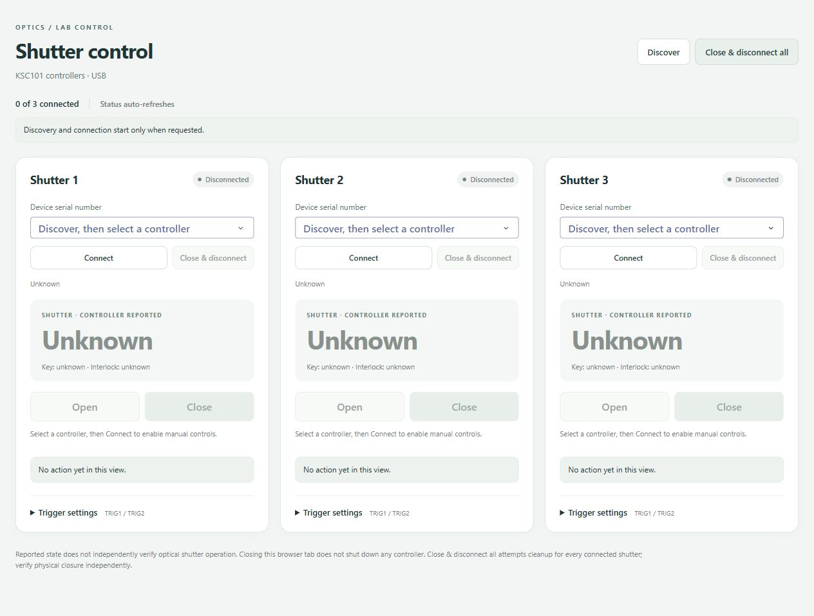

# Thorlabs shutter control

A local Dash GUI and reusable Python API for a configurable number of **KSC101** solenoid
controllers. Control an **SH05R** optical shutter through the official Kinesis
SDK, directly by USB or through a **KEH3/KEH6** hub in USB mode. Each panel has explicit device
selection, Open/Close, trigger settings and cleanup. Startup is passive.


Manufacturer product photo: [Thorlabs optical shutters](https://www.thorlabs.com/optical-shutters).
It illustrates the supported device pair; it is not a photograph of the test bench.

## GUI



Actual application at startup, with no device selected or connected. Trigger
settings expand within each card; see the [GUI guide](docs/gui.md) for the second
screenshot and control behavior. These captures contain no bench identifiers.

## Install

From a local checkout, use Windows x64, Python 3.12 x64, [uv](https://docs.astral.sh/uv/)
and the official [Thorlabs Kinesis SDK/USB drivers](https://www.thorlabs.com/software-pages/Motion_Control).
The vendor runtime is installed separately from Python dependencies.

```powershell
uv sync --locked
uv run --locked pytest -q -p no:cacheprovider --ignore=tests/test_sdk.py
```

Default SDK folder: `C:\Program Files\Thorlabs\Kinesis`. Set `KINESIS_DIR` or
`--kinesis-dir` when needed. See [setup](docs/getting-started.md).

## Launch and operate

Keep the source independently disabled or blocked, preserve the normal physical
interlock, and close Kinesis/other controller owners. Match the physical shutter
to the serial found locally. Keep the actual value out of committed examples:

```powershell
uv run --locked shutter-control --list
$env:SHUTTER_SERIAL = Read-Host 'Controller serial from local discovery'
uv run --locked shutter-control --serial $env:SHUTTER_SERIAL --verified-interlock $env:SHUTTER_SERIAL
```

Use `--verified-interlock` only after verifying the normal interlock and independent
protection. It records selected-serial/session evidence without changing hardware
interlock settings. Key, identity and communication checks still apply. Omit it
for passive reads or where the device independently reports readiness.

Open [localhost:8050](http://127.0.0.1:8050/):

1. Discover/select the intended controller and Connect. Read identity and status.
2. Establish Closed, then use Open/Close within the approved operating limits.
3. Expand Trigger settings only when needed. Draft edits do not apply or arm.
4. Finish with **Close & disconnect all**, then normal terminal **Ctrl+C**.

Use `--slots 6` for six panels, or any positive count. Repeat `--serial` for
distinct devices in panel order; the default grows beyond three to fit them.
Without a slot count or more serials, three panels are shown. Unused panels
stay disconnected. Closing the browser does not shut down hardware. Cleanup is
best effort and cannot bound a hung SDK call; use independent bench recovery on
uncertainty. Reported states and software holds are not optical/timing measurements.

## Python API

```python
import os
from thorlabs_shutter_control import KCubeShutter

serial = os.environ["SHUTTER_SERIAL"]
shutter = KCubeShutter(serial)
# Only after normal physical interlock/source protection have been verified:
shutter.confirm_interlock(serial)
verified = False
try:
    shutter.connect()
    verified = True
    print(shutter.close_shutter())
finally:
    shutter.disconnect(close_shutter=verified)
```

[Hardware tutorials](docs/examples/README.md) cover discovery, passive reads,
Open/Close, three shutters and TTL. Read the [API](docs/python-api.md),
[interface contract](docs/INTERFACE.md) and [architecture](docs/architecture.md).

## Hub support and scale

The USB driver selects individual KSC101 identities and does not depend on a
three-bay hub. Thorlabs lists [KEH6](https://www.thorlabs.com/item/KEH6) as a six-bay
hub; the same addressing path is expected to work through KEH3/KEH6 USB or linked
USB hubs. KEH6 hardware has not been qualified here. Hub/power/USB limits still
apply; an arbitrary software count does not imply unlimited physical capacity or
simultaneous operation. Refresh and cleanup run sequentially, so latency grows
with the connected count. Ethernet remains experimental; the GUI uses USB.

## What has been tested

Qualified bench: computer -> USB -> KEH3 -> KSC101 -> SH05R; Windows x64,
Python 3.12.7, Kinesis 1.14.60.27990 and cube firmware 1.0.7. USB uses Kinesis/FTDI,
with no COM-port dependency. Published records use device aliases.

| Check | Evidence |
| --- | --- |
| USB identity, status, reconnect, Open/Close and shutdown | Controller readback passed; user confirmed the five-cycle physical sequence |
| GUI controls, refresh, reconnect and cleanup | Actual browser and USB readback passed |
| TTL, both ports disconnected | Configuration/Arm/Disarm passed; active-low Open expectation failed on both ports |
| Ethernet cube communication, three real pairs, external TTL signals/voltage, fault injection, calibrated timing | Not qualified |

[Results](records/hardware-validation.json), [TTL observations](records/ttl-summary.json)
and the [short hardware test procedure](docs/HARDWARE_VALIDATION.md) preserve these
limits. TTL Arm can open immediately; active-low remains a potential opening
condition with an unplugged input, despite the unresolved no-cable test result.

## Development

```powershell
uv run --locked python tests/simulated_demo.py --api
uv run --locked ruff check --no-cache src tests docs/examples docs/hardware_tests
uv build --wheel
```

The developer simulator never reaches the real SDK. The default test command
excludes opt-in real-SDK enumeration. See the [evidence index](records/RECORDS.md),
[current checkpoint](STATE.md) and [report](outputs/REPORT.md) for project status.
