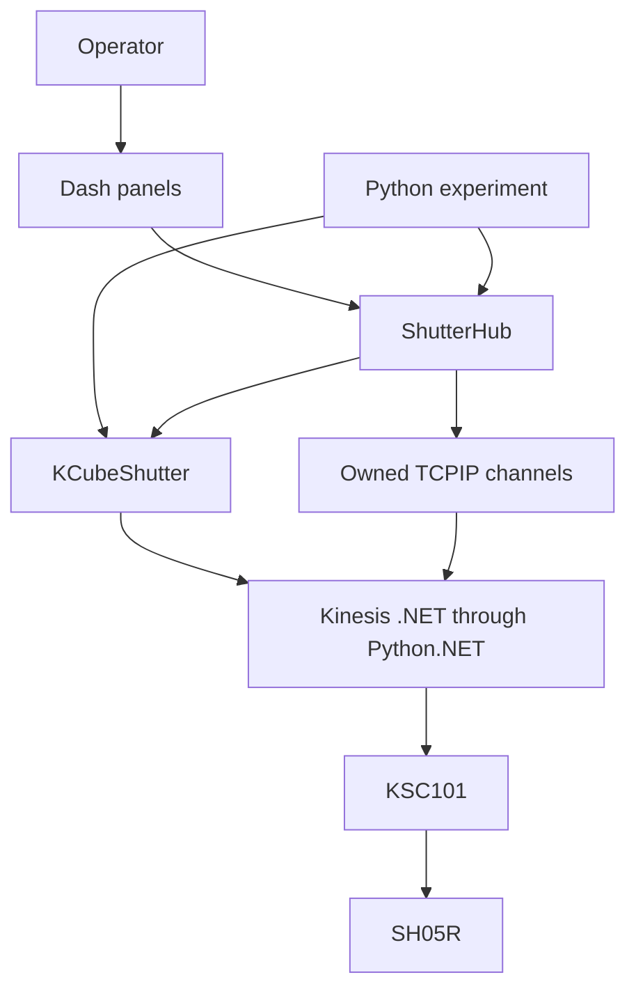

# Architecture

[README](../README.md) | [API](python-api.md) | [Interface](INTERFACE.md)

controller.py contains lazy SDK loading, transports, normalized feedback, direct
commands and exclusive serial ownership. KCubeShutter handles USB; ShutterHub
owns Ethernet routes, independent slots and dispatch. Shared internal Kinesis code
implements device lifecycle and commands. GUI construction requires a ShutterHub.

Unified discovery combines USB, configured routes and one bounded LAN scan.
The GUI caches successful serial/route choices, then explicitly configures the
selected route on Connect. Stale choices are rejected after a rescan. Retained
handles preserve identity/cleanup and prevent route replacement. Broad scans
require all process owners released. Construction/startup is passive.

## Control and ownership

Setters write and return None; getters request feedback. Setters invalidate
cached observations. Applications own sequencing, readiness and readback. The
GUI checks key/feedback/mode/input prerequisites before activation and reads the
selected panel after commands. Interlock feedback is informational; the physical
circuit and independent source protection remain operator responsibilities.

Each channel has a lock. SDK enumeration/handle creation and serial ownership use
a shared process lock. The hub serializes actions/status/shutdown. A failed native
release retains its handle and owner; cleanup never rebinds that target. Other
processes require operator exclusion. All-slot shutdown continues after failures
or interrupts and preserves the resulting errors.

__main__.py owns one localhost Werkzeug server. Its request loop exits after a
successful GUI cleanup and nonblocking shutdown notification; the response finishes
before listener closure. Cleanup failures keep it running. No reloader is used.

## Timing and validation

Default getter wait/polling is250ms. GUI Manual Open requests prerequisite and
result reads (0.50s programmed waits); Close requests a result read (0.25s).
Trigger Start adds an actual input-settings read. Refresh is requested every1s
and serial reads scale with connected count. Native calls may block; timeout
limits settings initialization/asynchronous discovery polling, not total native
duration. These are software waits, not calibrated optical timing.

Tests replace the SDK and use virtual waits, independent fake devices and real
Dash callback HTTP. Notebooks run only against those doubles during validation.
Physical evidence and limits are separate in [hardware evidence](hardware.md).
