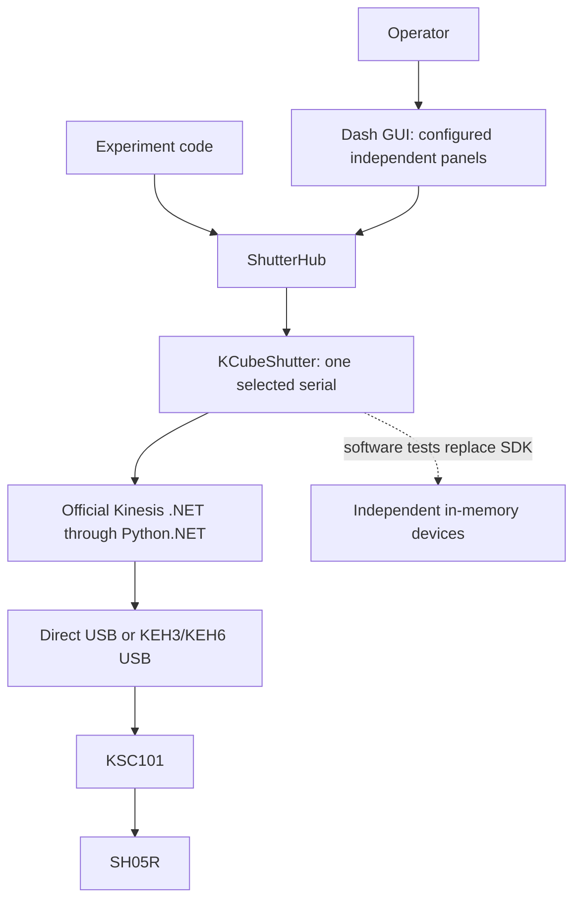

# Architecture

[README](../README.md) | [API](python-api.md) | [Interface](INTERFACE.md)

The diagram is editable Mermaid. `controller.py` contains lazy SDK loading,
normalized status/configuration, one-controller behavior and all-slot cleanup.
`gui.py` translates controls into driver/hub calls; it contains no vendor commands.
`__main__.py` owns one local server process and cleanup on normal exit.

## Boundaries

- Import, construction and unconnected GUI startup do not load the SDK. Discovery
  loads it explicitly; Connect initializes settings, polling, identity and feedback
  without explicit output/mode writes.
- Each controller has a lock. SDK enumeration/handle creation and serial ownership
  claims share a process-wide lock. Failed disconnect retains the handle/claim.
  Other processes must still be excluded by the operator.
- The hub serializes GUI actions/status and attempts every slot during shutdown,
  aggregating failures and preserving interrupts. Shutdown is sequential; a hung
  native call can prevent reaching later slots.
- Status faults latch and invalidate reported state. Close/cleanup remain available
  while a handle exists. Feedback waits are not calibrated sensor measurements.
- Open readiness combines an enabled key with reported interlock readiness or
  explicit operator verification when the SDK reading is unknown. Confirmation is
  object/serial scoped and clears on retargeting; it is never a hardware write.
- Close requires Closed/Inactive before selecting Manual, then verifies again.
  Open first establishes that baseline. TTL Arm uses device settings, not drafts;
  Close/Disarm/default cleanup do not restore the prior triggered/timed mode.

The GUI uses one callback and a panel count fixed for that session, configured
with `--slots N` or the number of preselected serials (default at least three). Draft trigger edits survive ordinary
refresh; Read replaces drafts. Trigger settings are natively collapsible. Status,
readiness hints and error styling derive from the same driver snapshots. A delayed
busy cue avoids highlighting every brief poll, without disabling Close.

Default polling is250ms and GUI refresh1s. A full status read waits one polling
interval for trigger settings. For N connected panels, reads add at least N *250ms of those
waits plus SDK time; six panels add at least1.5s. There is no app-defined count
cap, but host/SDK resources and sequential polling/cleanup limit practical scale. The5s feedback timeout applies per wait stage, not to total
shutdown or a blocking native call. No simultaneous/synchronized control claim.

USB is the qualified single-pair branch. Explicit Python Ethernet endpoints are
experimental and [passively software-tested](ethernet-assessment.md); cube Ethernet
hardware communication, three real devices and physical TTL remain separate.
