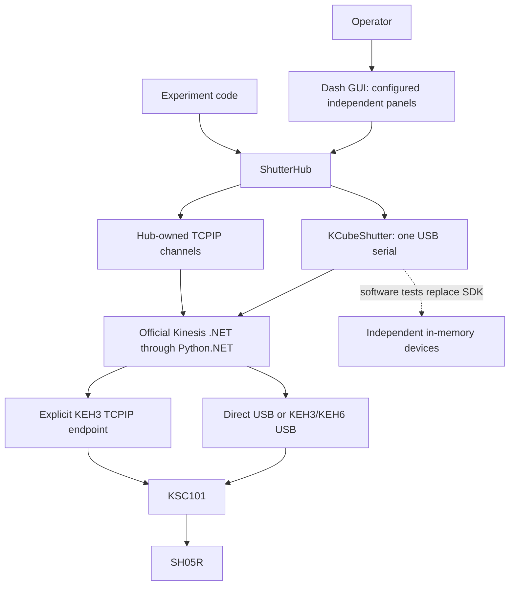

# Architecture

[README](../README.md) | [API](python-api.md) | [Interface](INTERFACE.md)

The diagram is editable Mermaid. `controller.py` contains lazy SDK loading,
normalized status/configuration, one-controller behavior and all-slot cleanup.
`gui.py` routes controls through the hub slot API; it contains no vendor commands.
KCubeShutter handles USB only. ShutterHub owns network endpoints, discovery/filtering
and command dispatch. Private shared Kinesis code avoids duplicating get/set,
identity, ownership and cleanup behavior across transports.
`__main__.py` owns one local Werkzeug WSGI server and cleanup on normal exit.
Its single-request loop exits cooperatively after the GUI sends Close/releases
all devices and signals `on_shutdown`; the response finishes before the listener
closes. Cleanup failures leave the server running for retry. Imported/embedded
`create_app()` instances expose no stop button unless their host supplies this
notification callback. No process kill, reloader or background server is used.

## Boundaries

- Import/construction/startup are passive. Discovery loads the SDK explicitly.
  Connect initializes communication/polling and verifies identity without operating
  feedback requests or output writes.
- KCubeShutter separates writes from reads. Open/Close/Arm/Disarm/configuration
  send commands and return None. They do not query feedback, sleep, retry or
  recover automatically. Specific getters request only the selected feedback;
  full snapshots remain available for applications that need them.
- Open/Close send Active/Inactive only and preserve the mode/enable state.
  Explicit enable_device provides channel setup; Disarm sends Inactive/Manual.
  Arm retains its compound Enable/Triggered/Active sequence.
- Applications own readiness, sequence and verification. The GUI explicitly
  reads prerequisites for mode changes and Open/Start/Apply/Arm and reads the selected panel after a
  command. Hardware lessons also issue explicit reads. These application reads
  are outside driver setters.
- Setters invalidate display snapshots rather than inventing new physical state.
  Undefined operating feedback is unknown; communication/SDK exceptions latch
  faults. Close and release remain available after faults. Command completion
  does not establish physical closure or optical timing.
- Each controller has a lock. SDK enumeration/handle creation and serial ownership
  share a process-wide lock. Failed disconnect retains ownership; other processes
  must still be excluded by the operator.
- Hub shutdown attempts every controller and aggregates errors/interrupts.
  It sends Close commands and releases handles without verifying closure. Native
  calls can block subsequent work. Independent source protection remains necessary.

The GUI uses one callback and a configured panel count (default at least three).
Draft edits survive refresh; Read replaces drafts. Apply separately writes and
reads back settings. Arm reads actual device settings rather than GUI drafts.
Other panels keep their prior observations until periodic refresh. Confirmation
of the normal physical interlock is object/serial scoped; it is not a hardware write.
The GUI treats interlock feedback as informational: users manage the physical
interlock externally. GUI Open/Arm do not require software interlock confirmation.

Default polling and getter wait are 250ms. Driver setters have **zero programmed
waits**, excluding unmeasured vendor-call time. GUI Open adds explicit prerequisite
and result reads (0.50s programmed waits), Close adds a result read (0.25s).
Trigger Start additionally reads actual TTL settings (another 0.25s wait).
Periodic refresh still takes N * 250ms for N connected panels; a refresh in
progress can delay a click. There is no app-defined count cap or synchronization
guarantee. `timeout` applies to SDK settings initialization; setters do not have
feedback timeout loops. It does not bound a blocking native call.

USB has historical single-pair evidence. The changed command paths require new
bench qualification. Hub Ethernet endpoints remain experimental;
three real devices, physical TTL and calibrated timing remain separate gaps.

## Compact instrument panels

The compact modern view retains Kinesis per-controller mode selectors, flat state controls
and status lamps. Mode selection explicitly writes only the requested mode after
fresh Inactive/Closed feedback. The shared activation control is Open in Manual
and Start in Single/Auto/Trigger; Stop/Close always sends Inactive without changing
mode. Trigger Start rereads actual input configuration; drafts never authorize it.
Cycle durations/counts remain the controller's existing settings.
Ready is application command readiness and Error is a driver/communication fault;
these are not independent hardware Ready/Error measurements. Key, position and
operating activity come from controller feedback. The view never gates on
software interlock metadata. Grey denotes unknown feedback; selected modes reflect
readback rather than the requested value. Desktop panels wrap to one column on
narrow windows. Supplied native Kinesis screenshots are visual references only.
