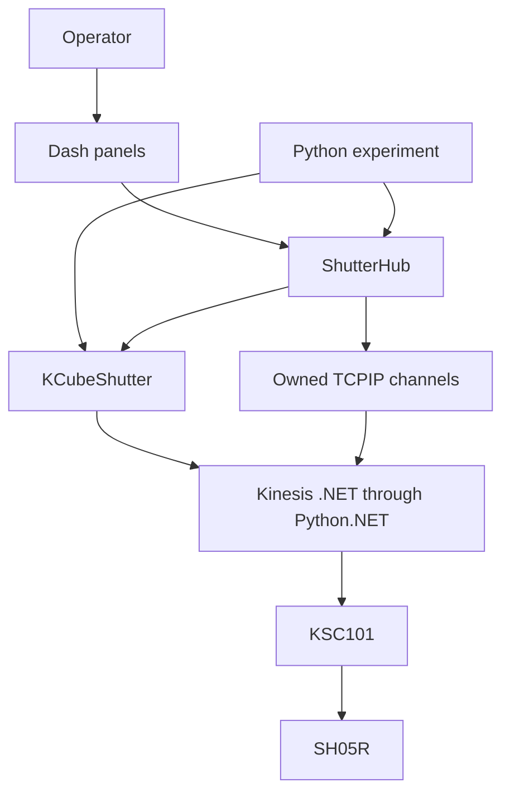

# Architecture

[README](../README.md) | [API](python-api.md) | [Interface](INTERFACE.md)

controller.py contains lazy SDK loading, transports, normalized feedback, direct
commands and exclusive serial ownership. KCubeShutter handles USB; ShutterHub
owns Ethernet routes, independent slots and dispatch. Shared internal Kinesis code
implements device lifecycle and commands. GUI construction requires a ShutterHub.

Unified discovery combines USB, configured routes and one bounded LAN scan.
The GUI caches successful serial/route choices, then explicitly configures the
selected route on Connect. Stale choices are rejected after a rescan. Retained
handles preserve identity/cleanup and prevent route replacement. Broad scans
require all process owners released. Construction/startup is passive.

## Control and ownership

Setters write and return None; getters request feedback. Setters invalidate
cached observations. Applications own sequencing, readiness and readback. The
GUI checks key/feedback/mode/input prerequisites before activation and reads the
selected panel after commands. Interlock feedback is informational; the physical
circuit and independent source protection remain operator responsibilities.

Each channel has a lock. SDK enumeration/handle creation and serial ownership use
a shared process lock. The hub serializes actions/status/shutdown. A failed native
release retains its handle and owner; cleanup never rebinds that target. Other
processes require operator exclusion. All-slot shutdown continues after failures
or interrupts and preserves the resulting errors.

__main__.py owns one localhost Werkzeug server. Its request loop exits after a
successful GUI cleanup and nonblocking shutdown notification; the response finishes
before listener closure. Cleanup failures keep it running. No reloader is used.

## Timing and validation

SDK polling defaults to 250 ms; feedback getters add no fixed sleeps. GUI Manual
Open requests prerequisite and result reads; Close requests a result read.
Connect requests one combined operating/TTL snapshot and uses it for the display
instead of requesting the result a second time.
Apply TTL keeps the prerequisite operating read, then shares one full snapshot
between actual TTL readback comparison and display.
Known Trigger Start includes input settings in its prerequisite snapshot; if mode
has changed, it obtains the required input settings before allowing Start.
Refresh is requested every 100 ms and paused during callbacks.
Serial reads scale with connected count. Native calls may block; timeout
limits settings initialization/asynchronous discovery polling, not total native
duration. SDK getters expose latest available values, which may precede the
request; no response-age or calibrated optical timing guarantee is established.
A settings comparison does not acknowledge a particular write. At a nominal ten
refreshes per second, each healthy connected panel would issue 30 explicit status/
mode/state request calls per second in addition to SDK polling. This is a call-rate
calculation, not measured transport throughput; callback duration reduces the
achieved rate. The operator table is in [GUI feedback timing](gui.md#feedback-timing); direct Python getter
contracts remain documented in the [API guide](python-api.md).

Tests replace the SDK and use virtual waits, independent fake devices and real
Dash callback HTTP. Notebooks run only against those doubles during validation.
Physical evidence and limits are separate in [hardware evidence](hardware.md).

## Developer walkthrough

Start here if you know basic Python and are new to instrument control. Kinesis is
Thorlabs' software development kit (SDK). Python.NET lets Python call its .NET
classes. A device handle is the Python-visible SDK object for one cube; retaining
that object preserves the target for cleanup. FTDI and TCPIP are the SDK's USB and
Ethernet provider names. TTL means the controller's electrical trigger interface.

### Reading order

| Read | Responsibility |
| --- | --- |
| [config.py](../src/thorlabs_shutter_control/config.py) | Defaults, including panel count, SDK folder and LAN scan range |
| [__main__.py](../src/thorlabs_shutter_control/__main__.py): main | Construct the hub/app, serve localhost requests, clean up on exit |
| [gui.py](../src/thorlabs_shutter_control/gui.py): create_app, update, run_panel_action | Build panels, coordinate events, check prerequisites and send commands |
| [gui.py](../src/thorlabs_shutter_control/gui.py): _panel, _panel_view, _panel_outputs | Define layout, named presentation values and matching output wiring |
| [controller.py](../src/thorlabs_shutter_control/controller.py): ShutterStatus, TriggerConfig | Values passed between driver and GUI |
| [controller.py](../src/thorlabs_shutter_control/controller.py): ShutterHub | Own slots/routes and dispatch commands to their drivers |
| [controller.py](../src/thorlabs_shutter_control/controller.py): _KinesisShutter | Shared connection, feedback, commands and release |
| [test_core.py](../tests/test_core.py), [test_application.py](../tests/test_application.py) | Executable examples using fictional devices |

Read the normal command path before SDK loading or error cleanup. A slot is a
zero-based panel index. An Ethernet endpoint is one exact IPv4:port route. Polling
means the SDK updates feedback periodically; an explicit getter also requests
feedback without an added Python sleep. Neither a successful setter nor a sleep
proves blade motion.

### Trace one Open and one LAN Connect

GUI Open enters `update()` in create_app, which calls `run_panel_action()`. That
helper uses cached mode only to choose between operating feedback and a full
operating/TTL prerequisite snapshot. Readiness always uses requested feedback;
if the reported mode changed to Triggered, it separately obtains actual TTL input
settings before checking readiness. It calls hub.open_shutter(slot), which dispatches to the
channel's open_shutter(). That sends SDK SetOperatingState(Active). The callback
then reads the selected panel's operating feedback and updates its display. The
setter itself contains no readiness reads or sleeps. Close sends Inactive without
the Open prerequisite check, so it remains available after a communication fault.

GUI Connect chooses a serial and applies its detected route with configure_slot()
when needed. hub.connect() calls the selected channel's shared connect() method.
For USB, KCubeShutter.discover() enumerates USB identities. For LAN,
_HubChannel.discover() asks its hub's _discover_slot() for configured-route
identities. Current LAN discovery waits for all configured endpoints or its
deadline; the GUI feedback reductions do not alter that behavior. Base connect()
claims exclusive serial ownership, creates/connects the SDK handle, initializes
settings/polling and verifies identity/transport. GUI Connect then reads one full
operating/TTL snapshot and returns it to `update()` for display. A snapshot error
keeps the fault visible and activation disabled. Connection alone never enables
the channel or writes outputs.

### State and failures to preserve

- `has_device` means a handle is retained; it can be true while `connection` is
  faulted. Never discard that target or open a replacement after failed release.
- `get_status()` and `get_operating_status()` return a fault snapshot on read
  failure. Inspect `connection`/`error`. Narrow getters and commands raise
  `ShutterError`; their errors remain recorded on the channel.
- `_command()` guards operations, clears cached display feedback before writes,
  and records SDK failures. It does not read hardware or authorize output.
- `_release()` attempts StopPolling and Disconnect. Shutdown attempts every slot
  even after failure or Ctrl+C, then propagates errors/interrupts. This is why
  cleanup deliberately catches `BaseException`.
- Dash `no_update` leaves a browser property unchanged. Returning `None` sets a
  value; these are different choices. All tabs share one hub and its locks.

In Dash, `Input` properties trigger the callback; `State` properties supply values
without triggering it. Named `Output` groups describe where returned values go.
`create_app()` keeps discovery choices and last-read TTL settings in local variables
shared by its nested functions. Each call to `update()` creates one small dictionary
of changes per panel, handles the action, reads feedback, then calls `_panel_view()`.
An action can return its completed feedback snapshot so `update()` can reuse that
event's result. Read TTL also returns its full operating/trigger snapshot after
checking for errors and replacing the draft. None requests the usual result read;
previous events' snapshots are never reused as new action feedback.
Apply TTL still checks Closed/Inactive/Manual before writing. Its returned snapshot
is used only after checking for read errors and comparing actual TTL settings with
the requested draft. A failed read or mismatch cannot report successful Apply.
It keeps the existing hub lock throughout that sequence so commands cannot overlap.
Discover uses get_cached_status().has_device for local handle ownership; it does
not request operating feedback just to retain a selection. Periodic refresh
remains responsible for updating held channels' displayed feedback.

### Develop without hardware

Use the install/test commands in [Setup](getting-started.md). Tests request the
`bench` fixture from tests/conftest.py; pytest supplies fixtures by argument name.
It replaces `_load_sdk` with fictional USB/LAN devices and replaces time with a
virtual clock. SDK-style capitalized method names in those fakes match .NET. They
prove control flow, not electrical, optical or native SDK behavior. Run the tests
instead of launching the GUI against real hardware for development validation.

For a first change, add a readout of the existing `ShutterStatus.status_bits`.
Add its element to `_panel()` and its named component/property value to
`_panel_view()` in gui.py. `_panel_outputs()` derives Dash output wiring from that
same view; no separate field list or matching return position is needed. Rendering
and control hints perform no device I/O. Add a GUI assertion using `bench`, exercising
one and multiple panels. No new driver request is needed: operating snapshots already
contain the bits. Reuse the small HTTP helper in tests/test_application.py; it posts
the same Dash callback request as the browser without opening a server socket.

For configuration changes, trace the chosen setting from config.py to its consumer.
LAN bounds change the scan scope; timeouts bound discovery/initialization, while
polling_ms controls SDK polling rather than a Python feedback delay. Startup
must remain passive. Validate with the fake SDK, without executing a live scan.
