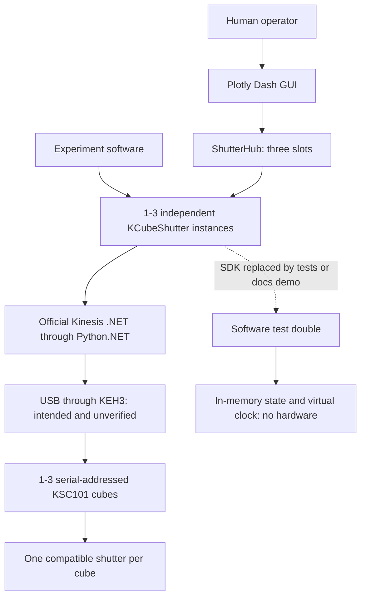

# Software architecture

[README](../README.md) · [Python API](python-api.md) · [Interface details](INTERFACE.md)

`KCubeShutter` controls one KSC101. The default Dash GUI owns three instances
through `ShutterHub`; experiment code can use either API. Both classes, status
and error types, SDK loading and device cleanup live in `controller.py`.
The intended physical path is KEH3 USB, pending bench validation; Ethernet control
is outside this implementation and hardware access remains on hold.

The hardware and fake paths are alternatives. The Mermaid source above is editable.

## What each part owns

| Part | Responsibility |
| --- | --- |
| Experiment code | Decide when to request actions and manage the controller's lifetime |
| Dash GUI | Show one panel per slot; translate independent controls to hub/controller calls; refresh every second |
| ShutterHub | Own one to three distinct controller objects; coordinate serial assignments and attempt shutdown for every slot |
| KCubeShutter | Validate inputs, exclusively own one serial within this process, serialize its calls, check feedback, latch faults and attempt cleanup |
| Kinesis / Python.NET | Load vendor assemblies, communicate over USB, maintain polling/cache behavior |
| KSC101 and shutter | Physical operation; this repository has not yet validated their bench behavior |
| Test fixture | Replace the SDK with an in-memory fake and virtual time for software checks |

GUI construction uses one panel function and reusable message/readout elements.
A single callback binds explicit per-slot outputs and named event/selection groups;
the hub lock still serializes each action with all status snapshots. Button and
interval counters use Dash's zero defaults. There is no widget framework, dynamic
command dispatch layer or separate callback owner per shutter.

## Connection, commands and state

Construction, package import and the initial GUI page do not load the SDK or
connect a device. Discovery loads Kinesis lazily and filters type `68`. Connection
discovers again, initializes settings if needed, starts polling, reads identity,
checks the returned serial against selection, and returns reported state.
It issues no explicit output-enable, mode or state
writes; physical side effects of vendor initialization still await validation.

Commands check reported state; faults invalidate `ShutterStatus` and block Open
until disconnect/reconnect. Close and cleanup remain available while a handle
exists. See [the API reference](python-api.md#shutdown-and-faults) for recovery
semantics and [INTERFACE.md](INTERFACE.md) for the exact vendor command sequence.

Open preparation calls `close_shutter()` before enabling the output. Close checks
Closed/Inactive before selecting Manual, then Closed/Inactive/Manual; Open also
checks Open/Active/Manual with enabled key/interlock. These waits read operating
feedback independently of TTL settings, so a settings fault cannot block disarm.
Command snapshots can omit trigger settings; get_status() reads the full snapshot.

`TriggerConfig` is an immutable normalized value; vendor enums/settings stay in
the driver. Status requests include both ports' settings and derived priming state.
Explicit Apply requires Closed/Inactive/Manual and matching readback. Arm closes
first, enables, selects Triggered and primes Active; failures attempt Disarm/Close.
Manual Open refuses Triggered. Close/Disarm/default shutdown require Closed/Inactive
before selecting Manual; otherwise mode is left unverified and release/all-slot
cleanup still proceeds. The GUI keeps draft selections
separate from readback and calls these same methods independently per slot.

## Timing and ownership

- Default vendor polling interval: **250 ms**. GUI refresh: **1 s**.
- Each settings read requests an update and waits one poll before reading the
  vendor cache. Three status snapshots therefore add at least 750 ms of settings
  waits at default polling, plus SDK time; refresh can take longer than its interval.
- Default feedback timeout: **5 s per wait stage**. Close/Disarm has two stages;
  Open and Arm each include those two plus one final confirmation stage.
  Native SDK calls may impose other waits; this is not an end-to-end deadline.
- One `RLock` serializes methods on each controller. A shared SDK lock serializes
  enumeration snapshots and handle creation; a process-wide serial registry
  prevents duplicate ownership. Failed disconnect retains both handle and claim
  until release succeeds. Other processes/vendor applications are not excluded.
- The hub lock serializes complete GUI actions/status snapshots with shutdown.
  Hub shutdown visits every slot sequentially and aggregates errors by slot and
  serial. An ordinary failure or interruption does not skip later attempts; a
  hung native call can prevent reaching them. There is no total shutdown deadline.
- Release attempts Disconnect even if StopPolling is interrupted, then preserves
  the interruption and any failed-release serial claim. Failed Open/recovery also
  latches a fault before propagating an interruption.
- The supplied CLI uses one process and a single-threaded local server, with debug
  and reloading disabled. Every browser tab shares that process's hub and handles.
- No exposure timing, real-time synchronization or multi-user ownership service
  is implemented. Keep one operator and one owner per physical device.

## Simulation boundary

`tests/conftest.py` supplies `FakeDevice` and the `rig` fixture. It replaces
`_load_sdk` and the controller module's clock with in-memory equivalents, and
provides independent fake devices for three fictional serials. Setters
normally update simulated position immediately; tests inject failures, stuck
feedback and connection errors. The fixture uses a 0.5 s timeout and virtual waits.

The documentation demo applies that fixture, passes a three-controller hub to
`create_app` or the API walkthrough, and restores the patch after cleanup.
It depends on test internals and is not a public simulation API.

Simulation validates decisions and UI plumbing. It cannot demonstrate DLL/driver
compatibility, wiring, key/interlock electrical behavior, mechanics, feedback age,
thermal limits, USB-loss latency or physical shutdown.

## Repository map

| Path | Purpose |
| --- | --- |
| [__init__.py](../src/thorlabs_shutter_control/__init__.py) | Public package exports |
| [controller.py](../src/thorlabs_shutter_control/controller.py) | `KCubeShutter`, `ShutterHub`, status/error types and real Kinesis implementation |
| [gui.py](../src/thorlabs_shutter_control/gui.py) | Three-panel Dash layout/callbacks; `create_app()` also accepts a hub or a single controller |
| [CLI entry point](../src/thorlabs_shutter_control/__main__.py) | `shutter-control` command and server shutdown |
| [assets/style.css](../src/thorlabs_shutter_control/assets/style.css) | Packaged GUI styling |
| [tests](../tests) | Controller, CLI, GUI and optional real-SDK tests |
| [pyproject.toml](../pyproject.toml), [uv.lock](../uv.lock) | Packaging and locked runtime/dev environment |
| [docs](.) | User guides, example harness and screenshots |
| [STATE.md](../STATE.md), [records](../records/RECORDS.md) | Checkpoint and traceable evidence |

Engineering operating instructions live in [AGENTS.md](../AGENTS.md).
