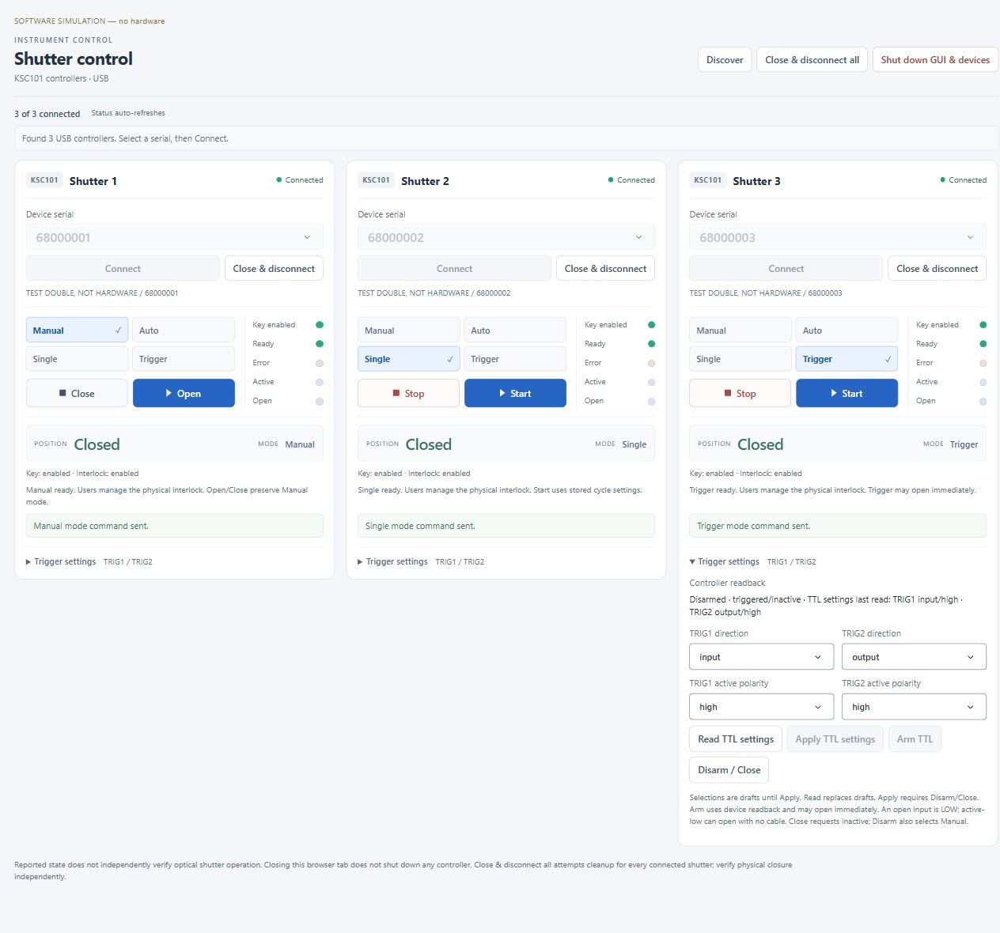
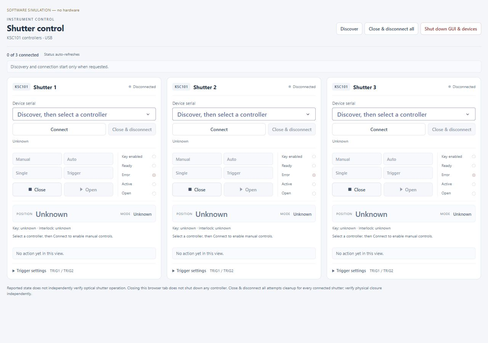
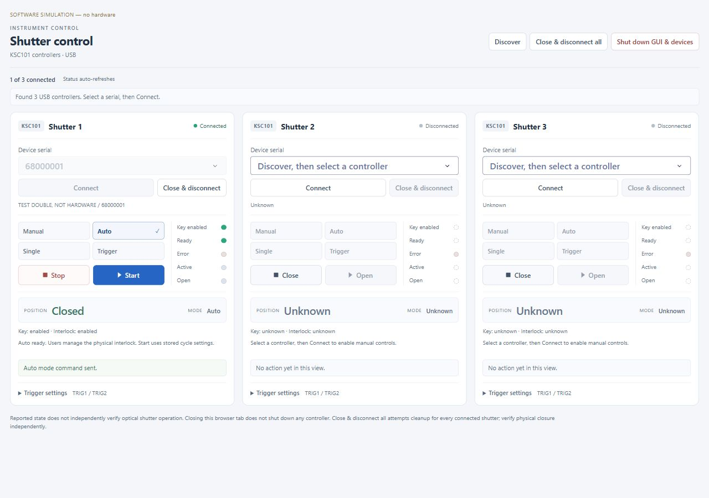
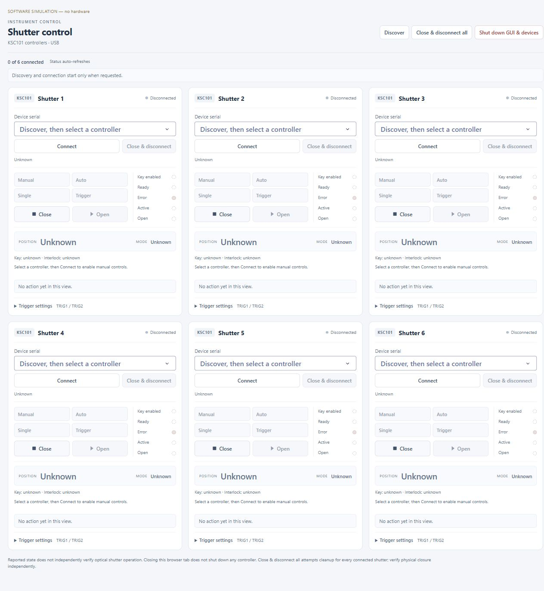

# Using the GUI

[README](../README.md) | [Setup](getting-started.md) | [API](python-api.md)

Edit [config.py](../src/thorlabs_shutter_control/config.py) if needed, then run:

```powershell
uv run shutter-control
```

Startup is passive. Visit [localhost:8050](http://127.0.0.1:8050/), then
Discover/select and Connect. Close Kinesis and other controller owners first.
Users set and verify the physical interlock externally. Interlock feedback is
informational and does not gate Open or Arm; no GUI confirmation is required.


Mode/feedback layout with three fictional software devices, captured before the
LAN selector/discovery controls were added. Compact neutral panels,
flat action buttons and status lamps retain the supplied Kinesis control layout
and its Manual, Single, Auto and Trigger modes. The screenshot is labelled
simulation and is not hardware evidence.

Panel count is configured in `config.py`: `SLOTS` accepts a positive integer.
The USB default is three or enough to fit all preselected serials. When Ethernet
endpoints are supplied, it fits those endpoint/serial lists. Larger layouts
wrap across rows; Discover does not resize the session or auto-connect devices.
The [375px preview](assets/gui-modern-narrow.png) shows the single-column layout
with expanded TTL settings.
Every launcher panel, including `SLOTS = 1`, requires a selected serial for Connect.
For one panel, Discover selects a sole discovered device in the visible dropdown.

## Ethernet LAN configuration

Click **Discover** to find USB and Ethernet controllers together. Choose a device
in a shutter's **Device serial** dropdown, then **Connect**. Each result includes
its detected transport; LAN results also show the endpoint. Connect applies that
route automatically. Discovery and selection do not connect or actuate a shutter.
There are no per-panel transport/endpoint controls or separate LAN scan block.


The LAN range and timeout come from `LAN_SCAN_START_IP`, `LAN_SCAN_END_IP`,
`LAN_SCAN_MAX_ADDRESSES` and `LAN_SCAN_OPEN_TIMEOUT_MS` in
[config.py](../src/thorlabs_shutter_control/config.py). Defaults are
192.168.1.0 through 192.168.1.255, inclusive, at most 256 addresses, 100 ms per
address. Restart the GUI after editing config.py. No exact device IP is needed.
Optional `SERIAL_NUMBERS`/`ETHERNET_ENDPOINTS` still supply startup selections and
explicit routes; configured routes are also checked during discovery.

Discover performs USB enumeration, configured-route discovery where applicable,
and one shared LAN scan for all cards. Broad LAN scanning requires every process
handle released. If a handle is retained or one transport fails, the GUI reports
the limitation and keeps successful results. Connected/faulted identities remain
visible and keep their cleanup path. Release controllers and close competing
Kinesis/notebook owners for a full fresh scan. Native SDK calls may block; an
empty result does not prove absence. Startup itself never discovers or connects.

Selections last for the server session. Changing a released panel's selected
device automatically configures the detected route on Connect; retained handles
cannot be replaced. No fallback to another endpoint/transport occurs after a
route is selected. Duplicate serial ownership remains refused. Multi-panel
Discover does not assign the same sole device to every empty card.
After any Discover attempt, Connect requires a result from that latest snapshot;
a stale browser selection cannot reconnect an omitted target on an old route.
Startup preselection can still connect before the first Discover.

KEH3 uses port40303 for the hub,40304/40305/40306 for left/middle/right bays and
40307 for USB OUT. Only matching type68 TCPIP identities are LAN controller
results. Follow the [LAN setup guide](ethernet-assessment.md), including USB IN
disconnected for Ethernet. KEH6 LAN mapping remains unsupported. The screenshot
uses fictional software devices and is not hardware validation.

## Main controls

| Control/readout | Behavior |
| --- | --- |
| Connection badge/count | Healthy connected panels; a fault can retain a handle even when excluded from the count |
| Transport label | Selected detected route before Connect; configured route while a handle is retained |
| Device serial | Explicit target with detected USB/LAN route; locked while a handle is retained |
| Discover | Shared USB/configured-route/LAN discovery using config.py; labelled results appear in each panel; partial failures and retained identities stay visible |
| Connect | Verify serial, initialize communication/polling and read feedback; no explicit output/mode write |
| Reported state | Open, Closed or Unknown; text/color reflect controller feedback, not optical proof |
| Key/interlock | SDK indication plus optional operator evidence; a clear interlock bit stays unknown, and neither indication nor confirmation gates commands |
| Mode selectors | Manual/Single on left, Auto/Trigger on right; require fresh Inactive/Closed feedback before writing the selected mode |
| Open / Start | Manual sends Active as Open; Single/Auto/Trigger sends Active as Start; uses fresh connection/key/feedback and actual trigger input settings |
| Status lamps | Key, command readiness, driver/communication error, Active and Open feedback; unknown readings stay grey; Ready is a GUI predicate, not a physical interlock report |
| Close / Stop | Send Inactive only, preserve mode, then read operating feedback; available with a retained handle, including fault |
| Readiness hint | Explains command availability for the selected mode |
| Action feedback | Last action/error in this browser view; ordinary refresh preserves it, reload starts a new view |
| Close & disconnect | Close then release; errors remain visible even when release succeeds |
| Close & disconnect all | Attempt every slot despite failures/interrupts; no total latency guarantee |
| Shut down GUI & devices | Launcher only: Close/release all devices, then stop the local Dash server; cleanup failures keep it running for retry |

Each card puts mode, state controls and feedback together. Trigger
settings are collapsed initially and keyboard operable. The delayed busy cue and
aria-busy mark pending requests without disabling Close during polling. A blocking
SDK call can still delay later controls; Close is not an independent emergency stop.

Open/Start assumes an enabled controller and never enables or changes mode
implicitly. If setup is needed, use the [explicit API sequence](python-api.md#connection-and-manual-control)
to Disarm, verify Closed/Inactive/Manual, and Enable once, then release that owner
before connecting the GUI. There is no Enable button in this GUI. In Manual, Open/Close send Active/Inactive. In Single and Auto, Start
uses the controller's stored cycle settings; this GUI does not read or edit cycle
timing/counts. In Trigger mode, Start primes the selected input behavior and may
open immediately. It rereads device TTL settings rather than trusting drafts or
the last-read summary. Use Stop before switching modes; mode changes do not
implicitly send Stop or Enable.

The GUI reads readiness before activating and reads the selected panel afterward.
A command-sent message is separate from observed state. Unknown position/mode/state
keeps activation unavailable. Single/Auto/Trigger Start requires Inactive/Closed;
Stop remains available with a retained handle. Arm TTL in the settings section
retains its explicit Closed/Inactive/Manual + input setup contract.
Shutdown sends Close/releases without closure readback. Other panels retain their
previous observation until periodic refresh; serialized reads may delay clicks.

After changing Python source, stop the old GUI in its terminal and relaunch
`uv run shutter-control`, then reload the browser. Reloading alone keeps the old
server code. Close other GUI/notebook/Kinesis owners before connecting. A native
Connect failure is distinct from a successful connection with unknown feedback;
retain the full error if a fresh single-owner session still fails.

## Trigger settings



The screenshot uses software device readback and draft controls. It does not
validate physical TTL behavior.

Expand **Trigger settings** to read/edit TRIG1/TRIG2. Opening/collapsing the section
issues no hardware command. Directions: disabled/input/output; polarity: high/low.

- Draft edits do not apply or arm. Ordinary refresh keeps drafts.
- Read TTL settings replaces drafts with device readback. The TTL settings summary
  is labelled **last read**; ordinary status refresh does not reread these settings.
- Apply requires Closed/Inactive/Manual and checks returned settings.
- Arm uses device settings, requires an input and readiness, and primes Triggered/Active.
- Armed and Closed can coexist with an inactive input. Disarm / Close explicitly returns Manual/Inactive; Close alone preserves mode.

Arm may open immediately. A disconnected input is documented LOW, so active-low
can open without a cable. Separate actual no-cable API tests applied/armed both
ports: configuration and Disarm passed, but active-low remained reported Closed.
[TTL results](../records/ttl-summary.json) retain that FAIL. External electrical
response remains unqualified; the earlier connected-browser test used Read only.

## Ownership and finish

All browser tabs share the same hub. Use one operator; process-local duplicate
protection cannot exclude vendor software or another Python process. Refresh is
requested every1s but serialized SDK operations can take longer. Layout/readiness
checks and actual single-pair browser tests are recorded in the
[hardware summary](../records/hardware-validation.json).

When launched with `uv run shutter-control` or `python -m thorlabs_shutter_control`,
use **Shut down GUI & devices** to Close/release every device and exit the server.
The response is returned before the listener closes. If cleanup fails, the server
stays available and shows the error so you can resolve it and retry. This releases
SDK connections; it does not power off controllers or independently prove closure.

**Close & disconnect all** keeps the GUI server running. Normal terminal Ctrl+C
also performs cleanup. Closing a tab or force-killing the process does not.
Embedded `create_app()` instances have no server-stop button by default; their
host may explicitly provide a nonblocking `on_shutdown` notification callback.

## Startup and Auto mode



Separate software-only preview before discovery or connection. Unknown lamps and
disabled actions reflect disconnected panels.



Auto selects Start/Stop like Single and Trigger. This fictional-device capture
shows the layout; it does not measure a physical cycle or its stored timing.

## Six-panel layout



Current styling with six explicitly configured empty panels. No discovery or
hardware connection occurred; this is layout evidence, not six-controller
qualification. Historical captures remain in the [asset index](assets/README.md).
