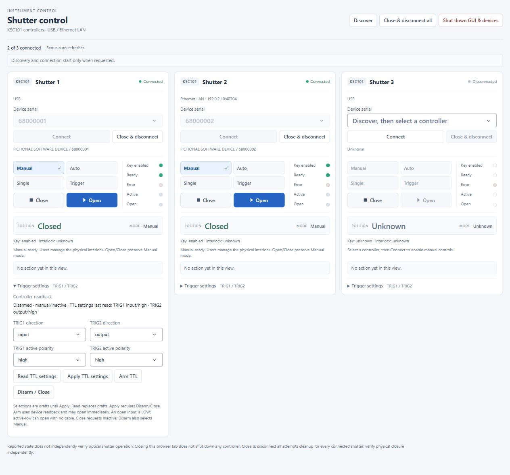
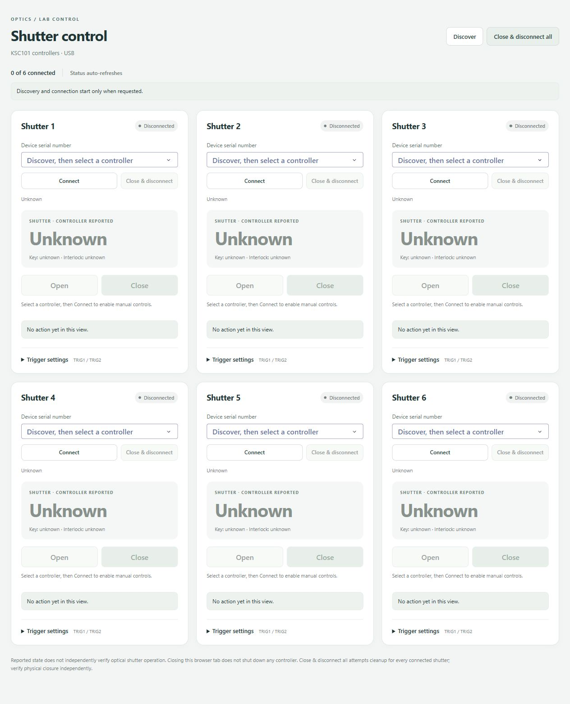

# Using the GUI

[README](../README.md) | [Setup](getting-started.md) | [API](python-api.md)

Edit [config.py](../src/thorlabs_shutter_control/config.py) if needed, then run:

```powershell
uv run shutter-control
```

Startup is passive. Visit [localhost:8050](http://127.0.0.1:8050/), then
Discover/select and Connect. Close Kinesis and other controller owners first.
Users set and verify the physical interlock externally. Interlock feedback is
informational and does not gate Open or Arm; no GUI confirmation is required.


Privacy-safe capture of the real application: no controller selected, no hardware
connection. Unknown states are startup feedback, not a bench observation.

Panel count is configured in `config.py`: `SLOTS` accepts a positive integer.
The default is three or enough to fit all preselected serials. Larger layouts
wrap across rows; Discover does not resize the session or auto-connect devices.
Every launcher panel, including `SLOTS = 1`, requires a selected serial for Connect.
For one panel, Discover selects a sole discovered device in the visible dropdown.

## Main controls

| Control/readout | Behavior |
| --- | --- |
| Connection badge/count | Healthy connected panels; a fault can retain a handle even when excluded from the count |
| Device serial | Explicit target; locked while a handle is retained |
| Discover | USB enumeration without connection/output; preserves retained identities |
| Connect | Verify serial, initialize communication/polling and read feedback; no explicit output/mode write |
| Reported state | Open, Closed or Unknown; text/color reflect controller feedback, not optical proof |
| Key/interlock | Raw SDK indication; unknown(operator verified) identifies separate session evidence |
| Open | Healthy identity/communication, enabled key and known operating feedback required; manual Open requires Manual mode |
| Close | Send Inactive only, preserve mode, then explicitly read operating feedback; available with a retained handle, including fault |
| Readiness hint | Explains a disabled Open or indicates manual readiness |
| Action feedback | Last action/error in this browser view; ordinary refresh preserves it, reload starts a new view |
| Close & disconnect | Close then release; errors remain visible even when release succeeds |
| Close & disconnect all | Attempt every slot despite failures/interrupts; no total latency guarantee |

The active card puts state, manual controls and feedback together. Trigger
settings are collapsed initially and keyboard operable. The delayed busy cue and
aria-busy mark pending requests without disabling Close during polling. A blocking
SDK call can still delay later controls; Close is not an independent emergency stop.

Manual Open assumes an enabled controller and does not enable or switch modes.
Use Disarm / Close to select Manual when needed. Driver setters only send commands. The GUI checks fresh readiness before Open,
then separately reads the selected panel after Open/Close. Messages say that a
command was sent; the state readout is an independent controller observation.
A single read may precede physical settling and is not optical proof. Shutdown
sends Close and releases without closure readback. Other panels keep their last
observation until periodic refresh. Serialized reads can still delay a click.

Open stays disabled when position, operating mode or operating state is unknown,
even after a successful identity connection. Arm requires Closed/Inactive/Manual,
key readiness and a last-read input configuration; clicking Arm rereads
the device settings before checking again. Labels reflect configured USB/Ethernet
hub transports; the standard launcher uses USB.

After changing Python source, stop the old GUI in its terminal and relaunch
`uv run shutter-control`, then reload the browser. Reloading alone keeps the old
server code. Close other GUI/notebook/Kinesis owners before connecting. A native
Connect failure is distinct from a successful connection with unknown feedback;
retain the full error if a fresh single-owner session still fails.

## Trigger settings



The screenshot shows draft controls; its disconnected state has no device readback.

Expand **Trigger settings** to read/edit TRIG1/TRIG2. Opening/collapsing the section
issues no hardware command. Directions: disabled/input/output; polarity: high/low.

- Draft edits do not apply or arm. Ordinary refresh keeps drafts.
- Read TTL settings replaces drafts with device readback. The TTL settings summary
  is labelled **last read**; ordinary status refresh does not reread these settings.
- Apply requires Closed/Inactive/Manual and checks returned settings.
- Arm uses device settings, requires an input and readiness, and primes Triggered/Active.
- Armed and Closed can coexist with an inactive input. Disarm / Close explicitly returns Manual/Inactive; Close alone preserves mode.

Arm may open immediately. A disconnected input is documented LOW, so active-low
can open without a cable. Separate actual no-cable API tests applied/armed both
ports: configuration and Disarm passed, but active-low remained reported Closed.
[TTL results](../records/ttl-summary.json) retain that FAIL. External electrical
response remains unqualified; the earlier connected-browser test used Read only.

## Ownership and finish

All browser tabs share the same hub. Use one operator; process-local duplicate
protection cannot exclude vendor software or another Python process. Refresh is
requested every1s but serialized SDK operations can take longer. Layout/readiness
checks and actual single-pair browser tests are recorded in the
[hardware summary](../records/hardware-validation.json).

Finish with Close & disconnect all, verify the reported result and physical
closure as required by the bench procedure, then normal terminal Ctrl+C. Closing
a tab or force-killing the process does not perform orderly shutdown.

## Six-panel example



Captured historically with six configured slots; all panels remain unconnected. This is layout evidence,
not a six-controller hardware test.
