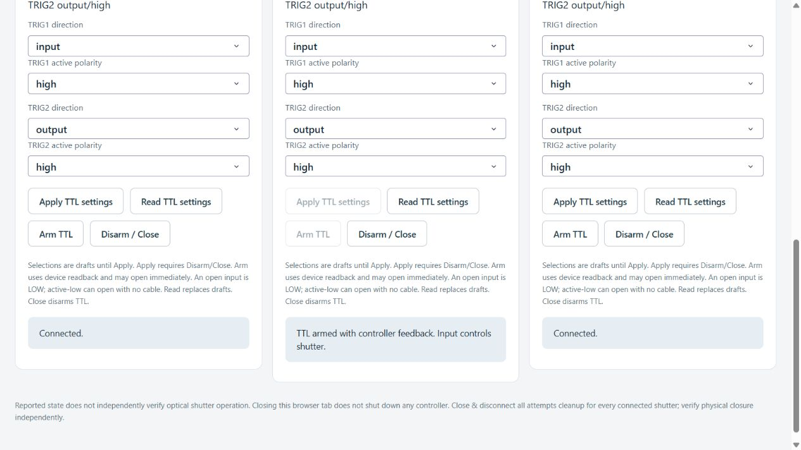
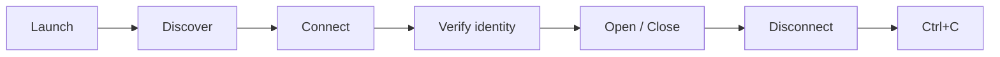
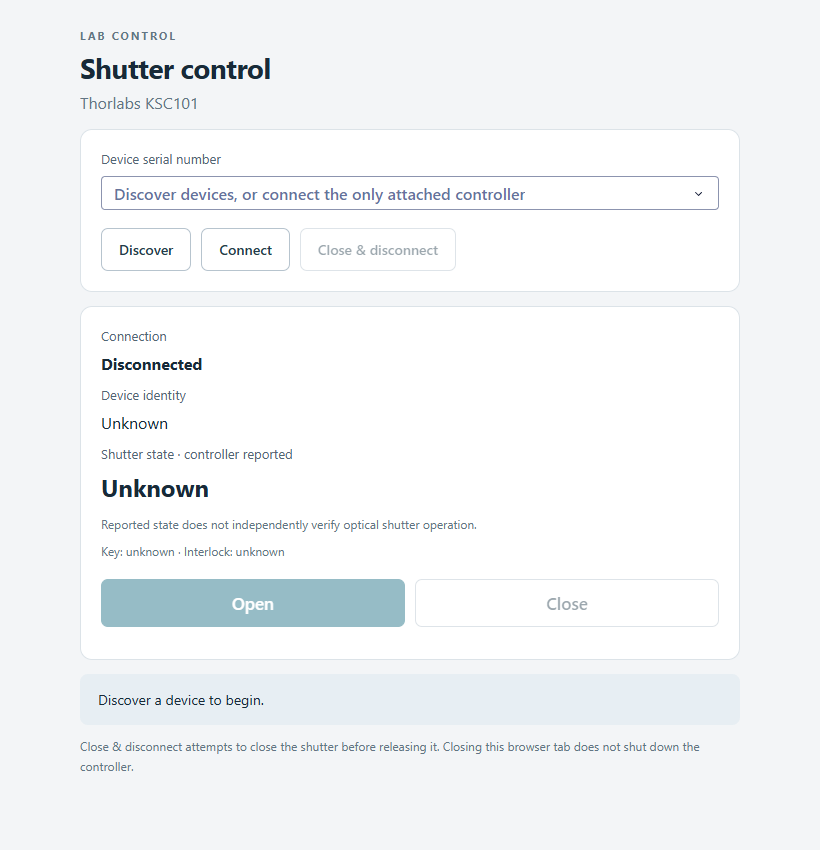
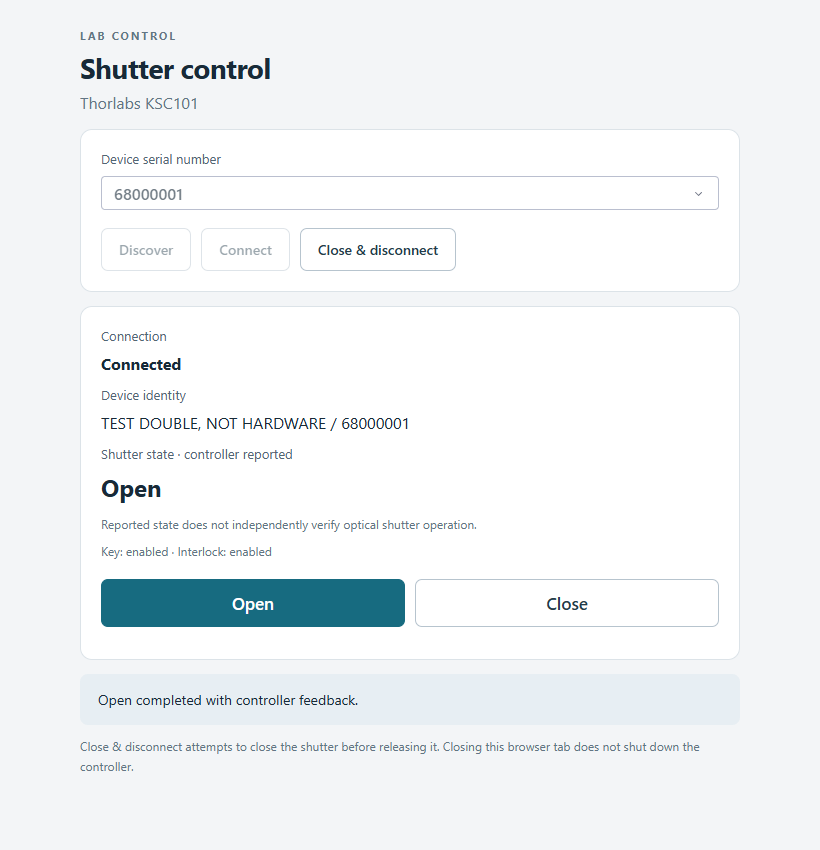
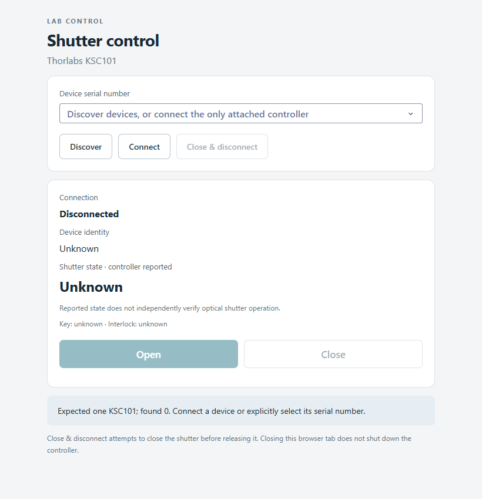

# Using the Dash GUI

[README](../README.md) · [Getting started](getting-started.md) · [Python API](python-api.md)

## Launch

For a source-checkout simulation, after `uv sync --locked`:

```powershell
uv run --locked python docs/examples/simulated_demo.py
```

Open [localhost:8050](http://127.0.0.1:8050). The terminal stays running while you
use the browser. On an approved hardware setup, `uv run --locked shutter-control`
launches the hardware application instead; follow the
[hardware procedure](HARDWARE_VALIDATION.md) before Discover, Connect or actuation.
Neither launcher connects automatically.
The hardware application provides three independent panels. Preselect actual
serials with `--serial SERIAL1 --serial SERIAL2 --serial SERIAL3` (at most three,
all distinct), or use Discover and explicitly select a serial in each panel.
KEH3 USB is the intended connection; physical compatibility and operation remain
pending. Ethernet control is outside this implementation. Hardware access remains
on hold until the ordered procedure is explicitly approved.

## Read the controls


*Historical three-panel Dash page before TTL controls, with fictional serials `68000001`–`68000003`,
reporting Closed / Open / Closed from independent test devices. **TEST DOUBLE,
NOT HARDWARE** identifies simulation; this is not physical-device evidence.
[Full-size historical image](assets/gui-three-simulated.png).*

| Control or readout | What it does |
| --- | --- |
| **Device serial number** | Selects an identity returned by Discover, or preselected with the hardware CLI's `--serial`. Disabled while a device handle is retained. |
| **Discover** | One shared USB enumeration populates all three dropdowns and preserves valid selections. The three-panel GUI requires explicit serial selection; the single-controller integration view can select the sole result. |
| **Connect** | Connects only that panel's selected identity. A serial retained by another panel/controller in this process is refused. Does not issue explicit output/enable/mode writes. |
| **Connection** | Text indicator: Disconnected, Connected or Fault. Fault can coexist with a retained handle that still needs cleanup. |
| **Device identity** | Vendor description and selected serial. The description is cleared on release; the selected serial can remain visible. |
| **Shutter state · controller reported** | Open, Closed or Unknown. It is not independent verification of the blade or beam. |
| **Key / Interlock** | Enabled, not enabled or unknown from controller reports. These are status readouts, not switches to bypass safeguards. |
| **Open** | Requests manual opening. Enabled only for a healthy connection with key and interlock reported enabled. Remains available when already open. |
| **Close** | Requests closure. Available whenever a handle exists, including in a fault state; success is not guaranteed. |
| **Close & disconnect** | Attempts Close, stops polling and releases the device. Any failure is reported even though release is still attempted. |
| **Close & disconnect all** | Attempts cleanup for every panel in order. Reported failures do not skip later panels; inspect every result and independently verify every shutter. |
| **Message area** | Shows the latest action result or error. A latched controller fault takes precedence. Ordinary refresh does not erase the last action message. |

## TTL controls

Every panel has its own TRIG1/TRIG2 direction and active-polarity drafts, device
readback, **Apply TTL settings**, **Read TTL settings**, **Arm TTL** and
**Disarm / Close**. Directions are disabled/input/output; polarities are high/low.
Startup selections are proposals only. Connect/refresh show existing device
settings without applying or arming; refresh preserves edits.

Use Disarm / Close, edit, Apply, then inspect readback. Apply requires reported
Closed/Inactive/Manual. Read copies device settings into the drafts. Arm uses
current device settings, including when drafts differ, and requires an input,
healthy connection and enabled key/interlock. Readback shows priming independently
of position: **Armed / Closed** is possible. Manual Open is disabled in Triggered
mode. Close, Disarm / Close and default shutdown return to Manual/Inactive.
Faults show TTL Unknown and disable Apply/Arm; Disarm/cleanup remain available
while a handle exists. No panel's settings or arming are copied to another panel.
Disarm verifies operating feedback independently of TTL settings, so a failed
settings read does not prevent closure and return to Manual. The settings fault
stays latched until successful disconnect/reconnect.

**Arming may open immediately.** The manual describes disconnected inputs as LOW;
active-low may open with no cable. Verify approved wiring, source levels/polarity
and independent protection before physical TTL operation. Hardware remains on hold.



*Actual browser detail captured on 2026-10-20 using three software devices. Only
Shutter 2 is armed; Apply/Arm are disabled there, and Disarm remains available.
The simulated input is LOW and the stored polarity is high, so the armed shutter
reports Closed. This tests UI behavior, not real wiring or priming.*

Status refreshes once per second when callbacks can run. The supplied server is
single-threaded; one blocking operation can delay updates or controls for other
panels. Independent panels do not provide simultaneous commands or bounded
shutdown latency. All browser tabs share the same hub and connected handles;
use one operator. Process-wide ownership protection does not exclude another
application or process using the same physical cube.

## Normal workflow



In simulation, verify the test-double identity. With hardware, compare every
serial with its bench label and shutter/panel mapping, then follow the ordered approval/observation gates.
Commands and status come through the same Python controller in both cases.

### Before connection



*Historical single-panel simulated launch, before discovery. This screen alone does not mean that
zero devices exist: discovery has not run. The real application's initial page
is similarly passive and can load even without Kinesis installed.*

### Open



*Historical single-panel view after Open in simulation. The message confirms controller feedback from the fake.
The normal fixture updates immediately; this does not measure physical travel time.*

### No-device error

After stopping the first demo, run:

```powershell
uv run --locked python docs/examples/simulated_demo.py --empty
```

Click Discover, then attempt Connect in a panel. The historical single-panel
capture below illustrates the earlier empty-discovery error; the current
three-panel GUI reports missing selection/discovery errors per panel:



*Historical single-panel error produced by simulated empty discovery. The UI remains Disconnected;
Open/Close stay disabled and Connect remains available. A no-device error is
different from a communication fault on an existing connection.*

For a communication fault, the GUI instead shows **Fault / Unknown**, disables
Open, and permits Close/cleanup while a handle exists. Consult the error and
[troubleshooting guide](getting-started.md#troubleshooting).

## Disconnect and exit

Use **Close & disconnect all**, check every panel's result, then **Ctrl+C** in the
terminal. A panel's **Close & disconnect** affects only that panel. The hardware
CLI also attempts cleanup of all three slots when its server exits normally or
receives Ctrl+C. Cleanup is sequential and continues after reported errors or
interruptions; an interruption is re-raised after the remaining attempts. A hung
vendor call can still prevent later attempts, so no total latency is guaranteed.
Closing the browser tab does not shut down controllers. Forced process closure,
power loss or USB loss also prevent guaranteed closure.

A shutdown error must be resolved using the approved bench recovery method;
retrying a button is not independent evidence that the shutter is closed.
See [shutdown details](python-api.md#shutdown-and-faults) and
[screenshot provenance](#screenshot-provenance).

## Screenshot provenance

`gui-three-simulated.png` is the earlier three-panel application captured on
2026-10-20 as a 452 × 2237 px image, with three connected test devices and the
second simulated shutter Open. The simulated hub replaces the SDK before any
operation; see [historical screenshot evidence](../records/RECORDS.md#e016).

The other captures are historical single-panel screenshots from 2026-09-09 in
Edge 152.0.4191.66 through Playwright, at an 820 × 850 px viewport and scale 1.
They require the historical revision to reproduce the exact layout. The current
[demo](examples/simulated_demo.py) exercises the same states in three panels;
wait for callbacks to finish and move the pointer clear of controls before capture.
All test identities are fictional, and every image is simulation evidence only.

| Historical image | Steps in the historical single-panel GUI |
| --- | --- |
| `gui-disconnected.png` | Fresh normal demo, before Discover |
| `gui-connected-simulated.png` | Discover → Connect → Close |
| `gui-shutter-open.png` | From connected state, Open |
| `gui-error-state.png` | Fresh `--empty` demo, Discover → Connect |

Finish with Close & disconnect where connected, then Ctrl+C in the terminal.
