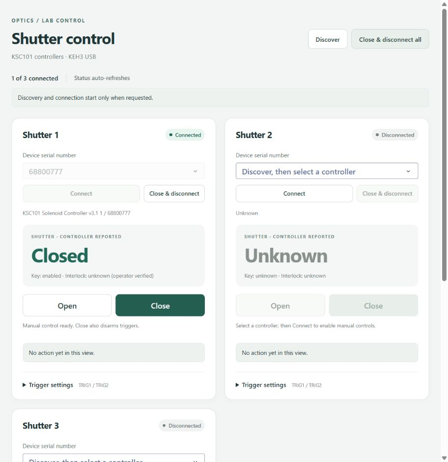

# Using the GUI

[README](../README.md) | [Setup](getting-started.md) | [API](python-api.md)

```powershell
uv run --locked shutter-control --serial 68800777 --verified-interlock 68800777
```

The confirmation records verified normal physical interlock/protection for this
selected serial/session only. It changes no hardware interlock setting. Startup
is passive. Visit [localhost:8050](http://127.0.0.1:8050/), then Discover/select
and Connect. Close Kinesis and other controller owners first.



## Main controls

| Control/readout | Behavior |
| --- | --- |
| Connection badge/count | Healthy connected panels; a fault can retain a handle even when excluded from the count |
| Device serial | Explicit target; locked while a handle is retained |
| Discover | USB enumeration without connection/output; preserves retained identities |
| Connect | Verify serial, initialize communication/polling and read feedback; no explicit output/mode write |
| Reported state | Open, Closed or Unknown; text/color reflect controller feedback, not optical proof |
| Key/interlock | Raw SDK indication; unknown(operator verified) identifies separate session evidence |
| Open | Healthy identity/communication, enabled key and interlock readiness required; manual Open refuses Triggered mode |
| Close | Attempt Inactive, verify Closed/Inactive, select Manual, then verify; available while a handle exists, including fault |
| Readiness hint | Explains a disabled Open or indicates manual readiness |
| Action feedback | Last action/error in this browser view; ordinary refresh preserves it, reload starts a new view |
| Close & disconnect | Close then release; errors remain visible even when release succeeds |
| Close & disconnect all | Attempt every slot despite failures/interrupts; no total latency guarantee |

The active card puts state, manual controls and feedback together. Trigger
settings are collapsed initially and keyboard operable. The delayed busy cue and
aria-busy mark pending requests without disabling Close during polling. A blocking
SDK call can still delay later controls; Close is not an independent emergency stop.

## Trigger settings

Expand **Trigger settings** to read/edit TRIG1/TRIG2. Opening/collapsing the section
issues no hardware command. Directions: disabled/input/output; polarity: high/low.

- Draft edits do not apply or arm. Ordinary refresh keeps drafts.
- Read TTL settings replaces drafts with device readback.
- Apply requires Closed/Inactive/Manual and checks returned settings.
- Arm uses device settings, requires an input and readiness, and primes Triggered/Active.
- Armed and Closed can coexist with an inactive input. Close/Disarm returns Manual/Inactive.

Arm may open immediately. A disconnected input is documented LOW, so active-low
can open without a cable. Physical electrical/TTL acceptance has not been performed.
The latest real-browser run used Read only, not Apply or Arm.

## Ownership and finish

All browser tabs share the same hub. Use one operator; process-local duplicate
protection cannot exclude vendor software or another Python process. Refresh is
requested every1s but serialized SDK operations can take longer. Layout/readiness
checks and actual single-pair browser tests are recorded in the
[hardware summary](../records/hardware-validation.json).

Finish with Close & disconnect all, verify the reported result and physical
closure as required by the bench procedure, then normal terminal Ctrl+C. Closing
a tab or force-killing the process does not perform orderly shutdown.
