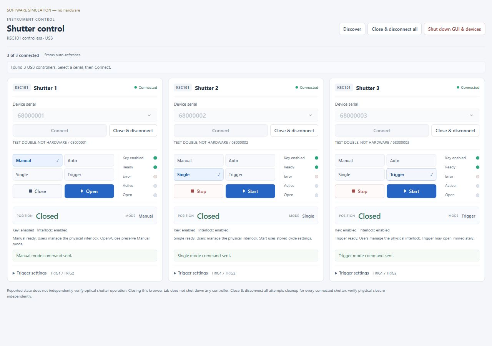

# Shutter controller report

The current software provides a passive local Dash GUI, USB-only KCubeShutter
and ShutterHub routing for USB or explicit experimental KEH3 Ethernet endpoints.
Serials accept strings or integers. Setters send commands and return None; getters
request feedback separately. Open/Close send Active/Inactive only, preserving mode
and enable state. Explicit Enable sets up the channel; Disarm sends Inactive/Manual
and Arm sends Enable/Triggered/Active. Users manage physical interlocks externally;
software interlock feedback and confirmation are informational.

## GUI and operation

Compact modern panels retain the Kinesis control layout and four modes. Manual
uses Open/Close; Single/Auto/Trigger use Start/Stop. Mode changes require fresh
Inactive/Closed feedback. Trigger Start rereads actual input settings; Single/Auto
use stored cycle settings. Ready describes application readiness; Error describes
driver/communication faults. Reported position is not independent blade sensing.

The launcher-owned shutdown button attempts Close/release on every device and
exits after returning its HTTP response. Cleanup failures leave the server
available. Embedded apps retain host ownership unless given a shutdown callback.
Browser closure does not stop devices; native SDK calls can block cleanup.

[Setup](../docs/getting-started.md), [GUI](../docs/gui.md),
[API](../docs/python-api.md), [architecture](../docs/architecture.md) and
[interface contract](../docs/INTERFACE.md) describe configuration and operation.
The [tutorial index](../docs/examples/README.md) includes USB and LAN notebooks,
explicit setup, feedback and cleanup. Published notebook outputs are clear.

## Current software validation

REQ-084 through REQ-088: **204 passed, 1 skipped** (optional real SDK); lint and
format PASS across32 source/test/example/helper files. Six current browser
captures cover startup, all four modes across main/Auto views, expanded TTL, six
empty panels and375px layout. Connected captures use fictional software devices.
No real SDK/device operation or live GUI restart occurred during these changes.
Preview servers exited normally and released listeners.

[Documentation validation](../records/documentation-review-validation.json),
[modern styling validation](../records/gui-modern-validation.json),
[four-mode validation](../records/gui-design-validation.json) and
[evidence index](../records/RECORDS.md) distinguish current source checks from
historical wheel/bench results. REQ-089 prunes superseded red-style screenshots
and repeated reporting while retaining useful tests and bench evidence.

All current screenshots and retained historical captures are indexed in
[asset provenance](../docs/assets/README.md). The historical
[supervisor notebook](supervisor-notebook.html) and its renderer preserve earlier
bench reporting; they do not qualify current command/GUI paths.

## Physical qualification limits

Historical single-pair USB/browser readback and user-observed motion remain
recorded. Changed command/GUI paths need affected bench validation. Cube Ethernet,
KEH6/multiple real pairs, electrical TTL, physical recovery and calibrated timing
remain unqualified. The active-low no-cable expectation failed and is unresolved;
see [TTL results](../records/ttl-summary.json) and
[hardware procedure](../docs/HARDWARE_VALIDATION.md). Software simulation cannot
resolve these physical gaps; no overall hardware completion is claimed.
